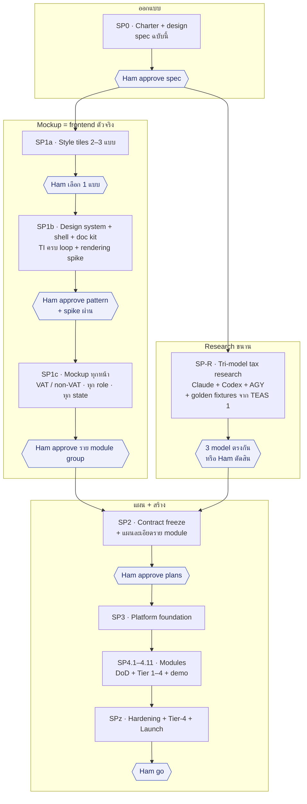
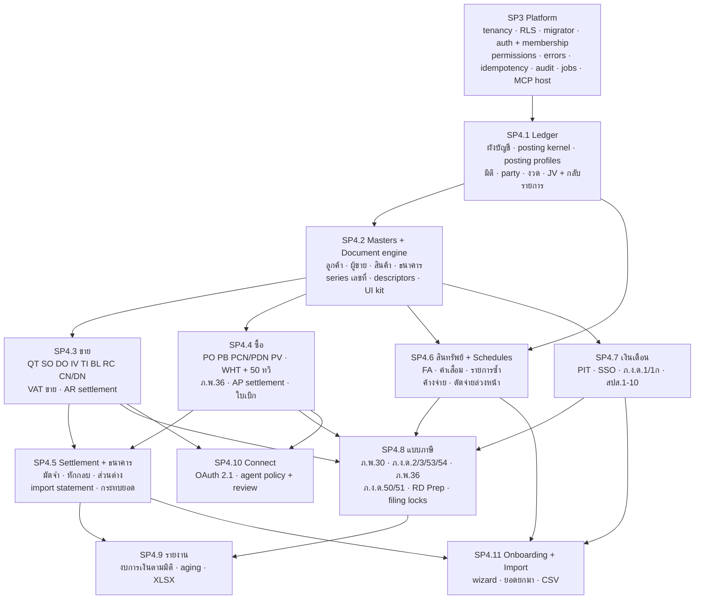
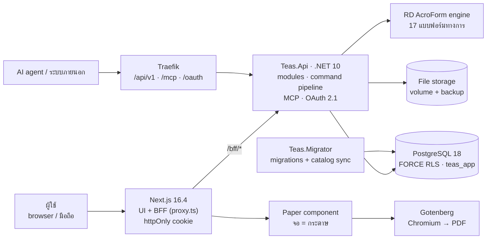
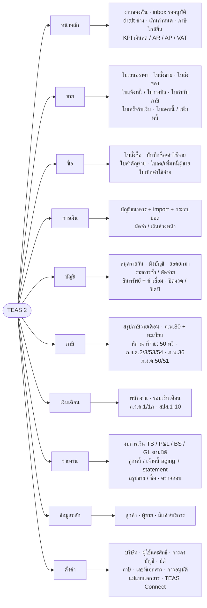
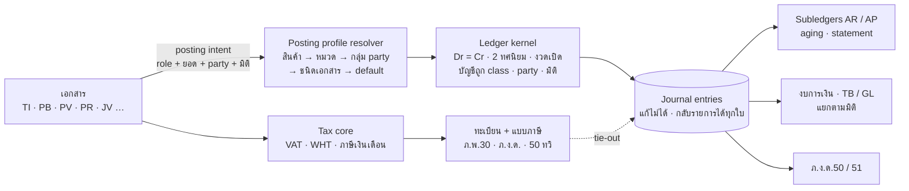
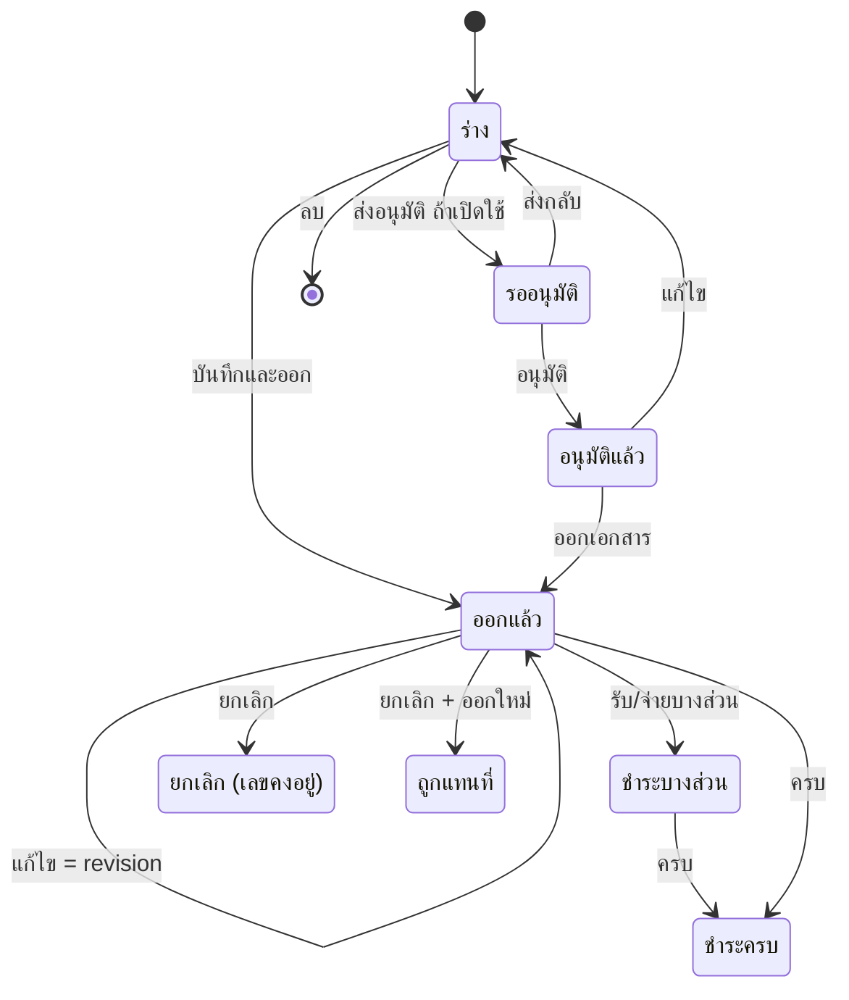
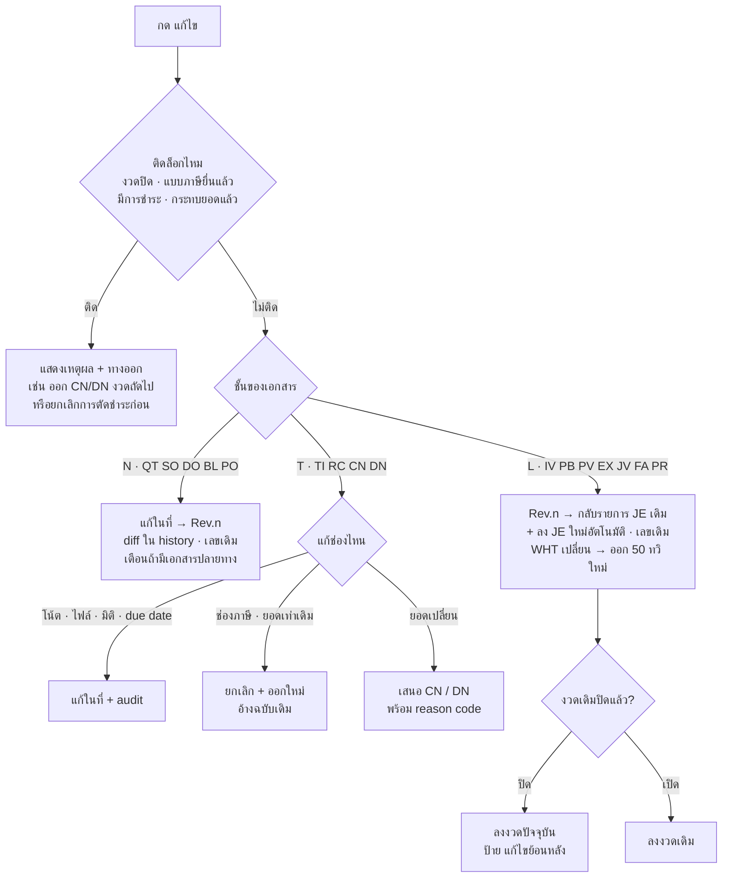
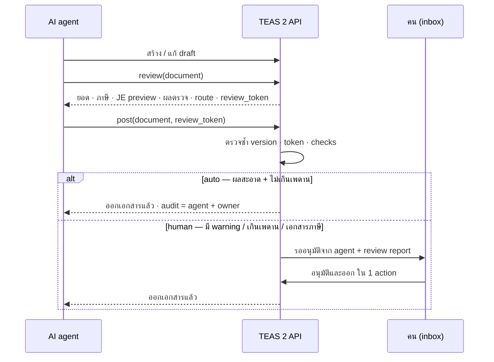
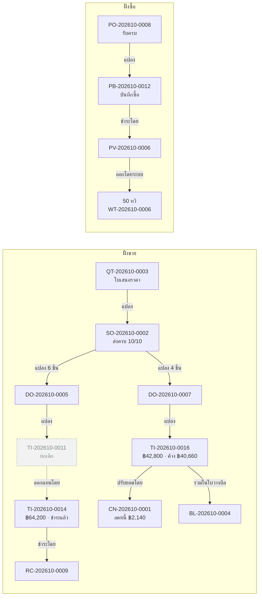
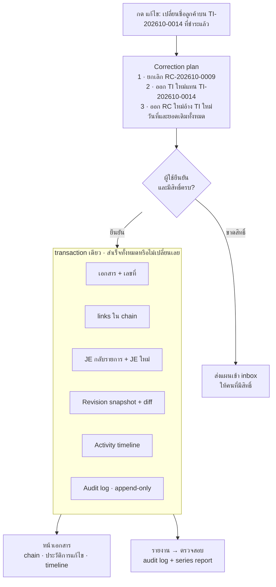

# TEAS 2 — SP0 Diagrams

Visual companion to [`SP0-charter.md`](SP0-charter.md). The spec is the source of truth: if a diagram and the
spec disagree, the spec wins and this file is corrected.

## 1. ภาพรวมแผน — sub-projects และ gates
> §11.2

ทุก sub-project วน spec → plan → execute และผ่าน gate ของ Ham ก่อนไปขั้นถัดไป · SP-R (research ภาษี) วิ่งขนานกับ mockup

## 2. ลำดับการสร้าง module
> §11.4

ลูกศร = ต้องเสร็จก่อน · MCP tools ของแต่ละ module generate จาก descriptor และออกพร้อม module นั้น

## 3. สถาปัตยกรรมระบบ
> §4, §10

browser ผ่าน BFF เสมอ · agent / ระบบภายนอกเข้าทาง Traefik ตรงเข้า API · app, test และ CI ใช้ role `teas_app` (ติด RLS)

## 4. แผนผังเมนู (IA)
> §9.1

จัดตามงาน ~35 รายการ (TEAS 1 มี 51) · ซ่อนรายการที่ไม่มีสิทธิ์ · บริษัท non-VAT ไม่เห็นเมนูเฉพาะ VAT

## 5. Accounting engine
> §5, §6.1

เอกสารไม่ระบุเลขบัญชีเอง — ส่ง posting intent ให้ ledger ตัดสินบัญชีผ่าน posting profile · แบบภาษีอ่านจากเอกสาร แล้ว tie-out กับ GL

## 6. Lifecycle ของเอกสาร
> §7.2, §7.6

ขั้นอนุมัติปิดเป็นค่าเริ่มต้น (เปิดรายชนิดได้) · ลบได้เฉพาะ draft ซึ่งยังไม่มีเลข · settlement มาจากใบเสร็จ/การจ่ายเท่านั้น

## 7. ปุ่ม "แก้ไข" หลังออกเอกสาร
> §7.3, §7.5

ปุ่มเดียวทุกเอกสาร — engine เลือกทางตามชั้น N / L / T · ถ้าติดล็อก แสดงเหตุผลพร้อมทางออก ไม่ซ่อนปุ่ม

## 8. Agent post เอกสาร (hybrid review)
> §8

agent ต้อง review ก่อนเสมอ · token ผูกกับ version ของเอกสาร · ผลสะอาดและไม่เกินเพดาน → auto, นอกนั้นส่งคนอนุมัติ

## 9. Document chain
> §7.11

ทุกความสัมพันธ์เป็น link มีชนิด · แปลงทีละบางส่วนได้ (ติดตามรายบรรทัด) · ใบที่ยกเลิกยังอยู่ในสายและชี้ไปใบที่ออกแทน · ยอดค้างคำนวณจาก link เท่านั้น

## 10. หนึ่งคำสั่ง = หนึ่ง transaction (chain-aware correction + log 3 ชั้น)
> §7.11, §7.12

แก้เอกสารที่มีใบอื่นผูกอยู่ → ระบบวางแผนทั้งสายให้ดูก่อน แล้วเขียนเอกสาร, link, JE และ log ทุกชั้นพร้อมกัน — สำเร็จทั้งหมดหรือไม่เปลี่ยนอะไรเลย

